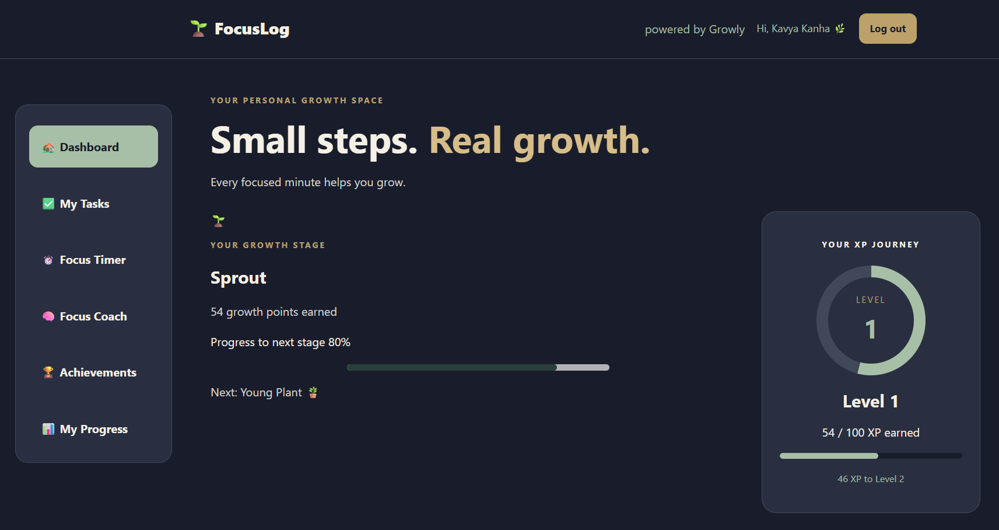
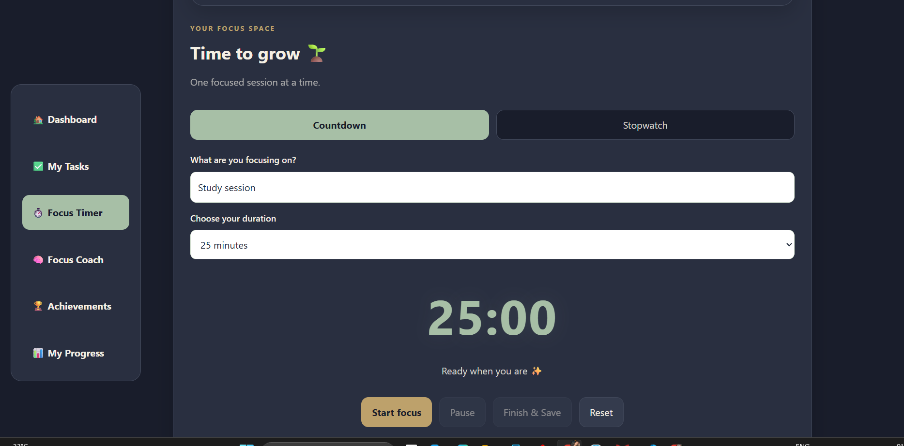
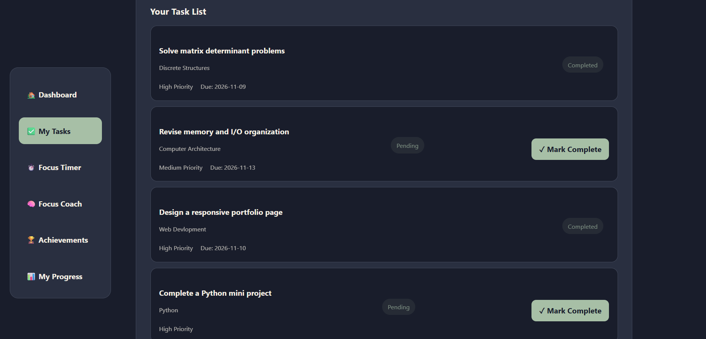
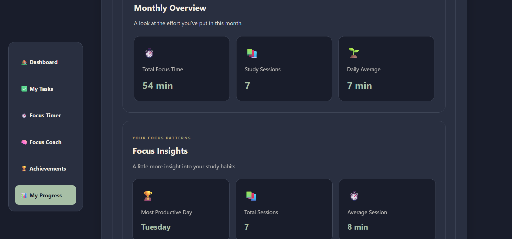
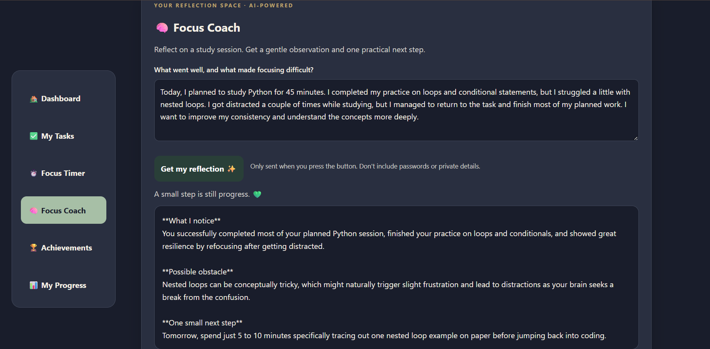

# FocusLog — Your Focus, Your Progress 🚀

A student productivity web application designed to help learners build consistent study habits, manage tasks, track focus sessions, and reflect on their productivity with AI-powered assistance.

🌐 **Live Demo:** [FocusLog](https://focuslog-z55d.onrender.com)

## ✨ Features

- **Pomodoro Focus Timer:** Track focused study sessions.
- **Task Management:** Create, manage, and complete daily tasks.
- **Productivity Analytics:** Monitor focus activity, productivity scores, and progress over time.
- **AI Focus Coach:** Receive AI-generated reflections and study guidance powered by Google Gemini.
- **XP and Levels:** Earn experience points through focused study sessions and progress through levels.
- **Achievements and Streaks:** Track consistency and unlock achievements.
- **User Authentication:** Account-specific email and password authentication.
- **Persistent Data Storage:** Store user accounts, tasks, and focus-session data using Neon PostgreSQL.

## 🛠️ Tech Stack

| Technology | Purpose |
|---|---|
| Python | Backend programming |
| Flask | Web application framework |
| HTML | Page structure |
| CSS | Styling and responsive design |
| JavaScript | Frontend interactivity |
| Neon PostgreSQL | Database |
| Google Gemini API | AI Focus Coach |
| Flask-Login | User authentication |
| Gunicorn | WSGI server |
| Render | Application hosting |

## 🏗️ Application Architecture

FocusLog connects its frontend, backend, database, and AI service.

1. The frontend handles user interactions.
2. Flask processes application requests and business logic.
3. Neon PostgreSQL stores account-specific application data.
4. The Gemini API powers the AI Focus Coach.
5. The backend returns the required responses to the frontend.

## 📸 Screenshots

Application screenshots will be added here.
## 📸 Screenshots

### Dashboard


### Focus Timer


### Task Manager


### My Progress


### AI Focus Coach



<!-- Add screenshots in this section -->

## 🚀 Run Locally

### Prerequisites

- Python 3.10 or newer
- Git
- A Neon PostgreSQL database
- A Google Gemini API key

### 1. Clone the repository

```bash
git clone https://github.com/KAVYA-CODES-1625/FocusLog.git
cd FocusLog
```

### 2. Install dependencies

```bash
python -m pip install -r requirements.txt
```

### 3. Configure environment variables

Create a `.env` file in the project root using `.env.example` as a reference.

Configure the following variables:

```env
FLASK_SECRET_KEY=your-secret-key
FLASK_DEBUG=0

GEMINI_API_KEY=your-gemini-api-key
GEMINI_MODEL=your-gemini-model

DATABASE_URL=your-neon-postgresql-connection-string
```

Google OAuth variables are also present in `.env.example`, but Google sign-in is currently disabled in the deployed application.

**Important:** Never commit your `.env` file, API keys, database credentials, or other secrets to GitHub.

### 4. Start the application

```bash
python app.py
```

### 5. Open FocusLog

Visit:

```text
http://127.0.0.1:5000
```

Create an account and start tracking your focus sessions!

## 🗄️ Database

FocusLog uses **Neon PostgreSQL** for persistent application data.

The database stores account-specific information, including:

- User accounts
- Focus sessions
- Tasks

Database credentials are configured through environment variables and are not included in the source code.

## 🤖 AI Focus Coach

The AI Focus Coach integrates the **Google Gemini API** to generate reflections based on user-submitted study information.

The API key is stored server-side as an environment variable and is not exposed to the browser.

## 🌱 XP and Achievements

FocusLog includes a progress-based system designed to encourage consistent study habits.

- Each valid focus minute earns 1 XP.
- Levels increase every 100 XP.
- Achievements unlock when their conditions are met.
- Growth stages represent the user's progress.

## 🔐 Security

- Environment variables are used for sensitive configuration.
- API keys and database credentials are not committed to the repository.
- Authentication is account-specific.
- Production deployment uses HTTPS and secure cookie configuration.

## 🌐 Deployment

FocusLog is deployed using **Render**, with **Neon PostgreSQL** providing persistent database storage.

**Live Application:** https://focuslog-z55d.onrender.com

## 🔮 Future Improvements

- Enhanced productivity insights.
- More personalized AI study recommendations.
- Additional progress visualizations.
- Further user experience improvements.

## 👩‍💻 About the Project

FocusLog was developed as a hands-on full-stack development project to explore backend development, database integration, API integration, authentication, and application deployment.

Built with Python, Flask, and a focus on helping students make their study time more meaningful.

---

**FocusLog — Small sessions. Consistent growth.** 🌱